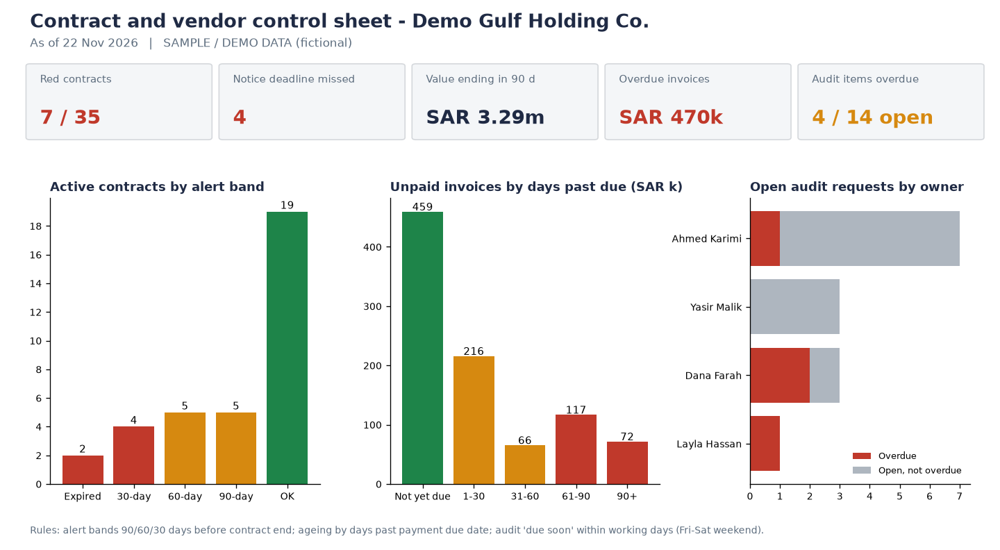
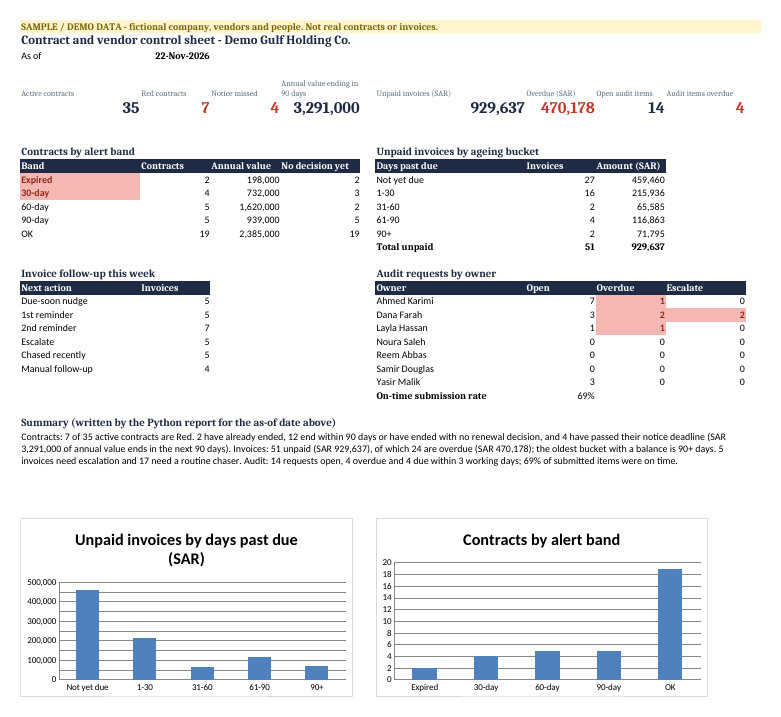
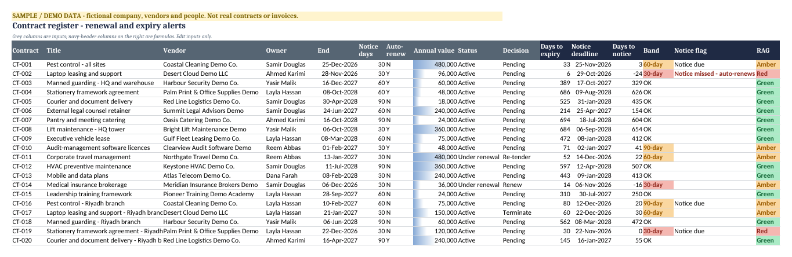
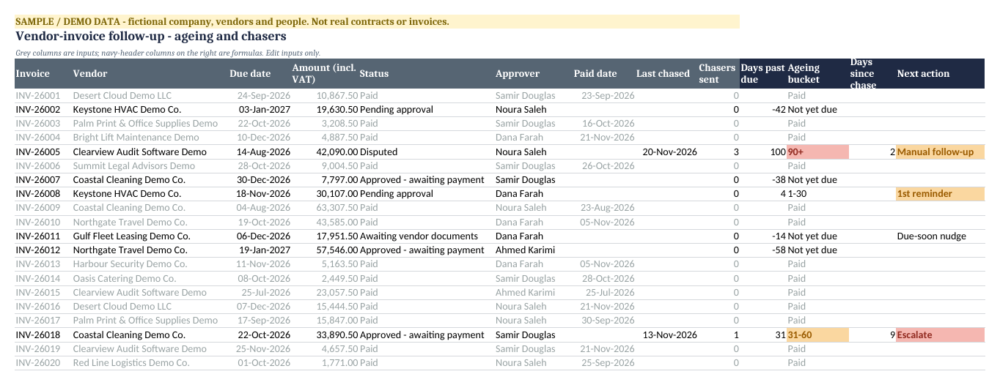
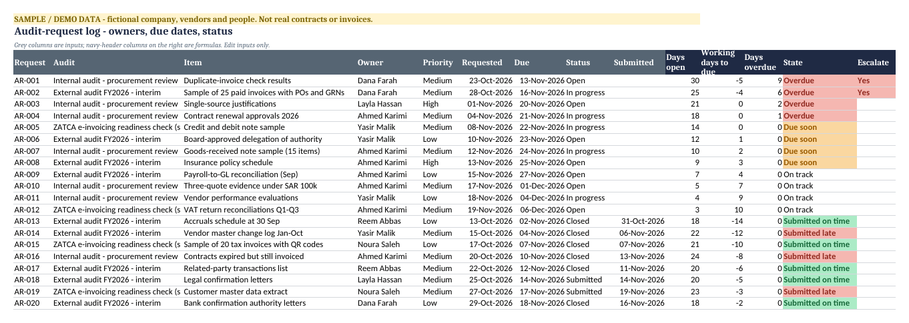
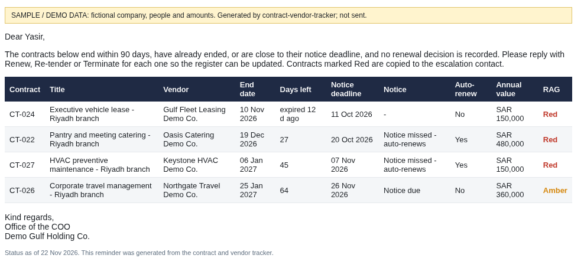
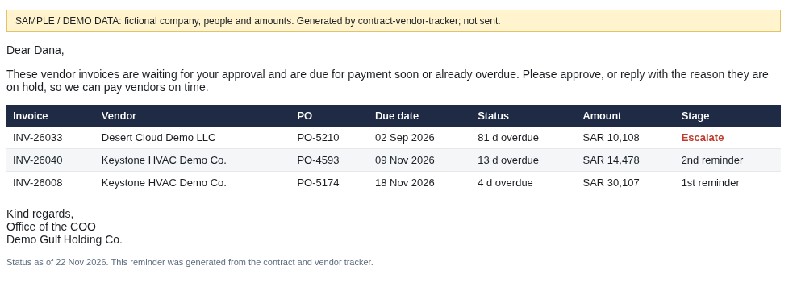
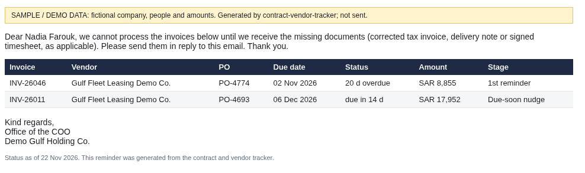

# Contract and Vendor Tracker


**Which contracts end or roll over in the next 90 days with no decision, which vendor invoices are
stuck or overdue, and which audit requests are late, and who needs a reminder about each one?**

This project answers that every week from four CSV files. It builds an Excel tracker with live
formulas, writes one reminder email per person as an Outlook-ready draft, and produces a one-page
control sheet. It runs offline and does not need Microsoft Office.

> **All data here is SAMPLE / DEMO DATA.** "Demo Gulf Holding Co.", its vendors, staff, contracts,
> invoices and audit requests are fictional, and every email address uses the reserved `.example`
> domain. This is a portfolio project, not work done for any employer or client. See
> [`sample_data/README.md`](sample_data/README.md).



## Contents

- [The problem](#the-problem)
- [What it does](#what-it-does)
- [Quick start](#quick-start)
- [Commands](#commands)
- [Screenshots](#screenshots)
- [How the rules work](#how-the-rules-work)
- [Power Automate version (not deployed)](#power-automate-version-not-deployed)
- [Using your own data](#using-your-own-data)
- [Project layout](#project-layout)
- [Testing](#testing)
- [Limitations](#limitations)
- [What I studied first](#what-i-studied-first)

## The problem

| Task | The manual way | What goes wrong |
|---|---|---|
| Contract renewals | Someone scans a spreadsheet of end dates now and then | The notice deadline (end date minus notice period) passes unnoticed and an auto-renewing contract rolls over for another year |
| Vendor-invoice follow-up | Finance asks "where is this invoice?" by email, one at a time | Invoices sit with an approver or wait for a vendor's corrected document until they are 60+ days late |
| Audit requests | The auditors' list lives in an email thread | Nobody knows which items are late or who owns them until the auditors escalate |
| Reminders | Writing a separate email for every item | People get five emails each, or none; escalations depend on memory |

## What it does

**1. Contract register with 90/60/30-day alerts**
- Days to expiry, notice deadline and days to notice for every contract
- Alert band: `Expired`, `30-day`, `60-day`, `90-day` or `OK` (thresholds set in `config.toml`)
- Flags `Notice missed - auto-renews`, `Notice missed` and `Notice due`
- RAG status: Red when a contract has ended, ends within 30 days, or missed its notice deadline with no renewal decision

**2. Vendor-invoice follow-up**
- Ageing by days past the payment due date: `Not yet due`, `1-30`, `31-60`, `61-90`, `90+`
- Next action for each unpaid invoice: `Due-soon nudge`, `1st reminder`, `2nd reminder`, `Escalate`, `Chased recently` (inside the 7-day gap) or `Manual follow-up` (disputed)
- The chaser goes to whoever is holding it up: the approver (pending approval), Accounts Payable (approved but not paid) or the vendor (documents missing)

**3. Audit-request log**
- Owner, due date and status for each item the auditors asked for
- `Overdue`, `Due soon` (within 3 *working* days, Fri-Sat weekend by default), `On track`, `Submitted on time`, `Submitted late`
- Escalates items more than 5 days overdue; on-time submission rate and open/overdue items by owner

**4. Reminder emails (drafts only)**
- One digest per person per topic, not one email per row; Red/escalated items copy the escalation contact
- Written as `.eml` files with plain-text and HTML parts. They open as editable drafts in Outlook (`X-Unsent: 1`) and also open in Thunderbird or Apple Mail. An `.html` preview and `outbox.csv` sit beside them
- Optional SMTP sending is **dry run by default**. Even with `--send`, anything addressed to a reserved test domain (`.example`, `.test`) is refused, so the sample drafts cannot be sent

**5. Excel workbook with live formulas** (`contract_vendor_tracker.xlsx`)
- Sheets: Dashboard, Settings, Contracts, Invoices, Audit requests
- Every rule above is also an Excel formula driven by named cells on the Settings sheet (`AsOf`, `Band1`, `Age1`, `ChaseGap`, `Weekend`...). Change a threshold or the date and the whole file updates
- Conditional formatting (RAG, bands, overdue), drop-down lists for status and decision fields, Excel tables (`tblContracts`, `tblInvoices`, `tblAudit`), frozen headers, A4 landscape print setup, two native Excel charts
- `NETWORKDAYS.INTL` with a configurable weekend for working-day counts

## Quick start

Python 3.12 or 3.13.

```bash
git clone https://github.com/amirator/contract-vendor-tracker.git
cd contract-vendor-tracker
python -m venv .venv
source .venv/bin/activate          # Windows: .venv\Scripts\activate
pip install -r requirements.txt
python -m cvtrack demo
```

Output:

```
Contract and vendor tracker - as of 2026-11-22
  Contracts  active  35  red  7  amber  9  notice missed 4  expired 2
  Invoices   unpaid  51  overdue 24  overdue SAR   470,177.50  escalate 5
  Audit      open    14  overdue  4  due soon 4  on-time rate 69%
  Reminders  20 drafts written (not sent)
Outputs in outputs/: contract_vendor_tracker.xlsx, weekly_summary.md, summary.json, control_sheet.png, reminders/*.eml|.html, reminders/outbox.csv
```

With `make`: `make demo`, `make test`, `make verify`, `make screenshots`, `make help`.

## Commands

| Command | What it does |
|---|---|
| `python -m cvtrack demo` | Run everything on the bundled sample data into `outputs/` |
| `python -m cvtrack run --data my_folder --as-of today` | Same, on your own CSVs and date |
| `python -m cvtrack send` | Dry run: list the drafts that would be sent. Sends nothing |
| `python -m cvtrack send --send --smtp-host smtp.office365.com --smtp-user you@company.com` | Send for real (password from `CVTRACK_SMTP_PASSWORD`). Reserved test domains are always skipped |
| `python -m cvtrack verify` | Recalculate the workbook in LibreOffice and check every formula cell against the Python result |

## Screenshots

All images are generated from the real demo outputs by `scripts/make_screenshots.py`.

**Excel dashboard** (live formulas, recalculated by LibreOffice for the screenshot)



**Contract register** (some input columns hidden for width)



**Invoice follow-up**



**Audit-request log**



**Reminder drafts**: contract owner, invoice approver, vendor





## How the rules work

All thresholds come from [`sample_data/config.toml`](sample_data/config.toml) and the Settings sheet.

| Area | Rule |
|---|---|
| Alert band | days to expiry < 0: `Expired`; <= 30: `30-day`; <= 60: `60-day`; <= 90: `90-day`; else `OK`. Terminated contracts are `Closed` |
| Notice | notice deadline = end date - notice days. Passed with no decision: `Notice missed` (`- auto-renews` if auto-renew = Y); within 30 days: `Notice due` |
| Contract RAG | Red = no decision and (expired, 30-day band or notice missed). Amber = any other alert band or notice due. Green otherwise |
| Ageing | days past due = as-of date - due date; buckets 1-30, 31-60, 61-90, 90+ |
| Invoice chaser | Skip if chased in the last 7 days. Pending approval: from 5 days before due. Approved: once overdue. Vendor documents: always. `Escalate` if > 30 days overdue or already chased twice |
| Audit | `Due soon` = due within 3 working days; `Overdue` = past due and open; escalate when > 5 days overdue |
| Reminders | Grouped by recipient. Escalations copy the escalation contact (never on vendor emails). Dated the next working day at 08:00 Asia/Riyadh |

Python (`cvtrack/contracts.py`, `invoices.py`, `audit.py`) and the Excel formulas implement the same
rules. `python -m cvtrack verify` and the test suite recalculate the workbook in LibreOffice and
compare all 621 formula cells, plus the dashboard totals, with the Python results, on two different
as-of dates.

## Power Automate version (not deployed)

[`power_automate/`](power_automate/) holds a cloud-flow definition for the contract reminders. It
runs weekly on Sunday 08:00 Arab Standard Time, reads `tblContracts` from the workbook in SharePoint,
filters to undecided contracts within 90 days, and either logs the email (`DryRun = true`, the
default) or sends it with Outlook, copying the escalation contact on Red items.

**It has not been imported into or run in Power Automate.** It is written by hand in the workflow
definition language Power Automate uses, in the shape of a solution export, with placeholder
connections. See [`power_automate/README.md`](power_automate/README.md).

## Using your own data

Put four CSVs and a `config.toml` in a folder (copy `sample_data/` as a template) and run
`python -m cvtrack run --data that_folder --as-of today --out my_outputs`.

| File | Required columns |
|---|---|
| `contracts.csv` | contract_id, title, vendor_name, owner, owner_email, end_date, notice_days, auto_renew (Y/N), annual_value_sar, status (Active / Under renewal / Terminated), renewal_decision (Pending / Renew / Re-tender / Terminate) |
| `invoices.csv` | invoice_id, vendor_id, vendor_name, invoice_date, due_date, amount_sar, status (Pending approval / Approved - awaiting payment / Awaiting vendor documents / Disputed / Paid), approver, approver_email, paid_date, last_chased, chase_count |
| `audit_requests.csv` | request_id, audit, item, owner, owner_email, requested_date, due_date, status (Open / In progress / Submitted / Closed), submitted_date |
| `vendors.csv` | vendor_id, vendor_name, contact_name, contact_email |

Dates are `YYYY-MM-DD`. Lines starting with `#` are ignored. Missing files, missing columns and
unknown statuses stop the run with a clear message.

## Project layout

```
cvtrack/            contracts.py, invoices.py, audit.py   rules
                    reminders.py, mailer.py              email drafts, optional SMTP (dry run default)
                    workbook.py, verify.py               Excel builder, LibreOffice recalculation check
                    report.py, cli.py                    summary, control-sheet PNG, command line
sample_data/        fictional CSVs + config.toml (+ README)
power_automate/     flow definition (not deployed) + README
scripts/            generate_sample_data.py, make_screenshots.py, validate_flow_schema.py
tests/              pytest suite
docs/               screenshots used in this README
outputs/            generated files (git-ignored)
```

## Testing

```bash
pip install -r requirements-dev.txt
python -m pytest -q
```

83 tests cover band and bucket boundaries (exactly 30/60/90 days), notice and RAG rules, every
chaser path, working-day counts across a Fri-Sat weekend, reminder grouping and escalation, HTML
escaping, the dry-run and reserved-domain guards in the SMTP sender (with a fake server), bad
input, the workbook's structure, the Power Automate file's structure, and a full demo run. GitHub
Actions runs the suite on Ubuntu and Windows with Python 3.12 and 3.13, and a separate job installs
LibreOffice and runs the formula-recalculation tests.

## Limitations

- **Sample data only.** Everything is fictional. Numbers describe the demo, not any real organisation.
- **The workbook has not been opened in Microsoft Excel.** It was built with openpyxl and checked by recalculating it in LibreOffice Calc. The functions used (IF, COUNTIFS, SUMIFS, NETWORKDAYS.INTL, IFERROR) exist in Excel 2010 and later.
- **The Power Automate flow is a design, not a deployed flow.** It needs real connections, the workbook stored in SharePoint or OneDrive, and testing with `DryRun = true` before use. Microsoft's Logic Apps schema does not list Power Automate's `OpenApiConnection` action type, so `scripts/validate_flow_schema.py` reports those two actions separately.
- **No emails were sent.** The SMTP path is tested only against a fake server.
- Dates are calendar dates; public holidays are not excluded from working-day counts (only the weekend).
- One currency per file (SAR in the demo). No ERP or procurement-system integration; data comes from CSV exports.

## What I studied first

GitHub search on 21 Nov 2026 for contract management, invoice tracking, contract renewal reminders
and invoice reminder emails. The repos for contract-renewal and invoice reminders are small (0-50
stars), so I took patterns from the stronger projects listed below. No code was copied.

| Repo | What I borrowed |
|---|---|
| [awdeorio/mailmerge](https://github.com/awdeorio/mailmerge) (MIT) | Dry run as the default, with sending as an explicit opt-in flag; sample files that work out of the box |
| [pnp/powerplatform-samples](https://github.com/pnp/powerplatform-samples) (MIT) | The shape of an exported flow (`properties.connectionReferences` + `definition`) and keeping flows in source control |
| [amirator/ea-office-automation-toolkit](https://github.com/amirator/ea-office-automation-toolkit) | My own earlier layout: one module per tool, `demo` command, sample-data banner on every file, scripted screenshots |
| Microsoft Logic Apps workflow definition schema (2016-06-01) | Validating the flow file's structure |

## License

MIT. See [LICENSE](LICENSE).
